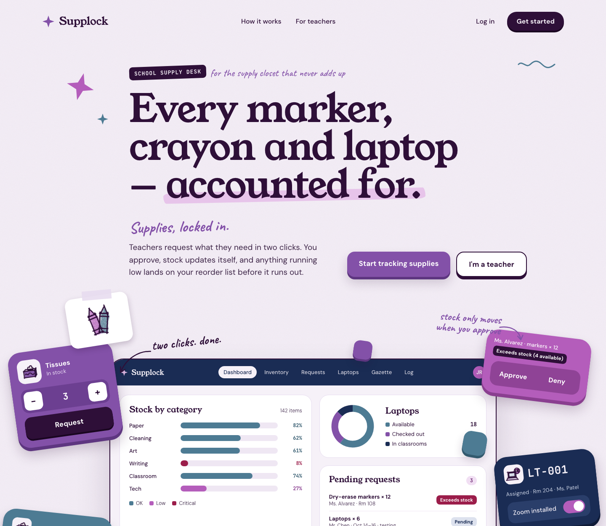
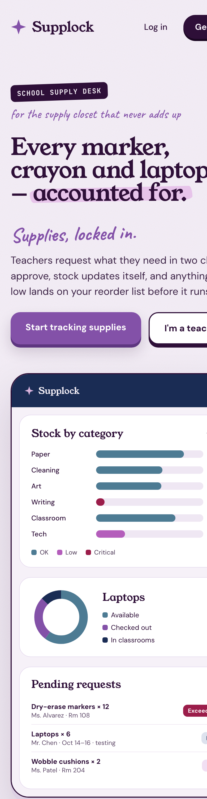

# Supplock

**Supplies, locked in.** A web app that helps schools run their supply closet: teachers request supplies, laptops and anything not on the shelf; admins approve, and stock, reorders and records keep themselves up to date.

**Live at [www.supplock.com](https://www.supplock.com)** · a multi-school, subscription product in real use.



## What it does

**For teachers**
- Browse the school's supply list (no prices or vendors) and request items in two clicks
- Request anything not listed, with a product link and a needed-by date, and borrow laptops (temporary checkout or full-time class use)
- Follow every request's status, get notifications in the app and by email, and keep their classroom's inventory up to date
- Send the office a quick note about shared things running low (copy paper, tissues) that nobody requests one at a time

**For admins**
- Notes from teachers on the dashboard, marked handled with one click (the teacher is told)
- Approval queue: approve, deny or change the quantity first. Stock only moves on approval and never goes below zero; requests that exceed stock are flagged
- Inventory with pack sizes, low-stock alerts, a shopping list grouped by vendor, reorders and partial deliveries, and **Excel import/export**
- Laptop cart tracking (tags, Zoom installs, checkouts, returns)
- **Spaces:** classroom and subject inventories (labs, gym, art room) with an owner, periodic counts and count history
- **The Supplock Gazette:** the to-do list, laid out as a vintage newspaper that writes its own headlines from what's happening in the closet
- A full, filterable transaction log of every stock change

**For the business**
- Multi-school from day one: each school registers, gets a join code, and only ever sees its own data
- Stripe subscriptions: three size-based plans, monthly or yearly, 14-day free trial, promo codes, and a self-service billing portal. Schools without an active plan become read-only; nothing is deleted

<p align="center"></p>

## Tech stack

| | |
|---|---|
| App | [Next.js 16](https://nextjs.org) (App Router, React Server Components, Server Actions, Cache Components), React 19, TypeScript |
| Database & auth | [Supabase](https://supabase.com): Postgres, Row Level Security, Auth, Storage |
| Payments | [Stripe](https://stripe.com) Billing: Checkout, Customer Portal, webhooks |
| Email | [Resend](https://resend.com), for app notifications and Supabase auth emails (SMTP) |
| Files | [ExcelJS](https://github.com/exceljs/exceljs) for .xlsx import and export |
| Hosting | [Vercel](https://vercel.com), with a custom domain |

## Engineering highlights

- **Business rules live in the database.** Every stock-changing action (requests, approvals, reorders, counts, imports) is a Postgres function (`security definer`) that checks who is calling and which school they belong to. The browser can read through Row Level Security but can never write stock directly. See [`supabase/migrations`](supabase/migrations).
- **Tenant isolation by design.** Every row carries a `school_id`, and RLS policies make cross-school access impossible even with a hand-crafted request.
- **One enforcement point for billing.** "Is this school's plan active?" is checked inside the same functions every write goes through, so a lapsed school becomes read-only everywhere at once. Teacher limits are enforced by a database trigger.
- **Reliable email without extra infrastructure.** Notifications double as an outbox. After each action the server claims unsent rows (`FOR UPDATE SKIP LOCKED`), sends them through Resend after the response (`after()`), and releases them for retry on failure, so nothing is sent twice and no click waits on email.
- **Safe password resets.** Reset links carry a one-time token that is only spent when the new password is saved, so email link scanners can't use them up.
- **Accessible, responsive UI.** Faithful to a high-fidelity design: keyboard-friendly dialogs, 44px tap targets, visible focus rings, reduced-motion support, and layouts that adapt from phones to wide screens.

## How it was built

I led this product from idea to launch and built it with **[Claude Code](https://claude.com/claude-code)** (Anthropic's AI coding assistant) as my development partner, working milestone by milestone: accounts, requests, approvals, inventory, laptops, spaces, the Gazette, the log, email, launch and billing. I set the requirements and priorities, made the product decisions (pricing, hosting, domain, billing rules), tested every feature end to end, and launched it on my own domain with real payments. Commits co-authored by Claude are marked as such.

Database rules were tested against a throwaway Postgres (PGlite) before each migration went live, covering stock never going negative, cross-school isolation, approval and reorder math, limits and billing states.

## Running it locally

1. `npm install`
2. Create a Supabase project and run the files in [`supabase/migrations`](supabase/migrations) **in order** in the SQL Editor.
3. Copy `.env.example` to `.env.local` and fill in the Supabase, Resend and Stripe (test mode) keys.
4. `node scripts/stripe-setup.mjs` creates the plans and billing-portal settings in your Stripe account.
5. `npm run dev`, then open [localhost:3000/setup](http://localhost:3000/setup) to check that everything is connected.

## Project layout

```
src/app/            pages and server actions (admin/, teacher/, login/, api/stripe/webhook)
src/components/     shared UI (headers, bell, icons, space inventory panel)
src/lib/            auth, Supabase clients, email outbox, Stripe, Excel, formatting
supabase/migrations database schema, Row Level Security and business rules (SQL)
scripts/            one-time Stripe setup
public/sl/          hand-drawn icon set and floating "block" widgets
design_handoff_supplock/  the original high-fidelity design prototype
```

---

© 2026 Mariam Muhammad. All rights reserved. This code is published so it can be read; it is not licensed for reuse.
